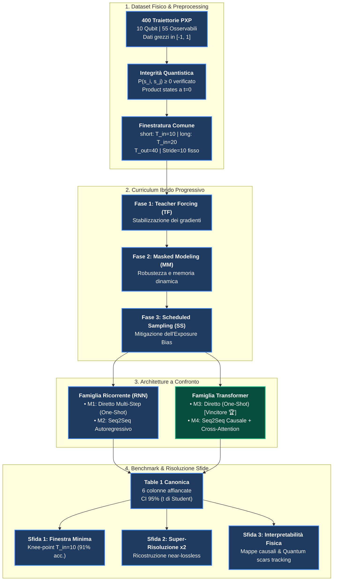
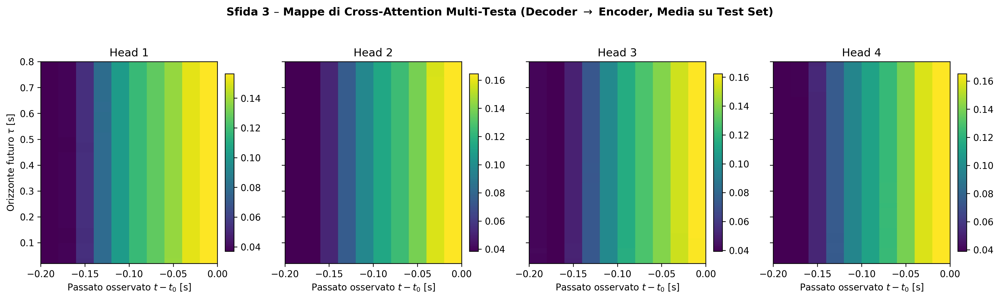
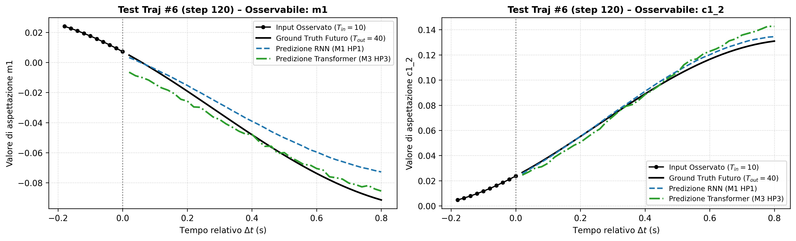

# DL-Quantum – Quantum Dynamics Forecasting in Rydberg Atom Arrays

[](https://www.python.org/)
[](https://www.tensorflow.org/)
[](https://keras.io/)
[](tests/test_pipeline.py)
[](https://en.wikipedia.org/wiki/Rydberg_atom)
[](report/Quantum_Dynamics_Report.pdf)
[](slides/Quantum_Dynamics_Slides.pptx)

Previsione della dinamica quantistica di non-equilibrio nel modello **1D PXP** (catena a 10 atomi di Rydberg) mediante modelli di Deep Learning ricorrenti e basati su attenzione (Transformer), addestrati con protocollo curriculum progressivo ibrido.

> ### 📦 Deliverables Ufficiali e Accesso Rapido
> | Deliverable | Descrizione | Formato & Collegamento |
> | :--- | :--- | :--- |
> | 📄 **Relazione Finale Ufficiale** | Articolo formale di **10 pagine**, layout accademico a due colonne (stile IEEE/NeurIPS), 16 figure, analisi statistica completa e riferimenti | [`report/Quantum_Dynamics_Report.pdf`](report/Quantum_Dynamics_Report.pdf) |
> | 📊 **Slide di Presentazione** | Presentazione ufficiale in **13 slide widescreen (16:9)**, grafica ad alta definizione, analisi disaggregata dell'errore e risoluzione sfide | [`slides/Quantum_Dynamics_Slides.pptx`](slides/Quantum_Dynamics_Slides.pptx) |
> | 📓 **Demo Live di Inferenza** | Pipeline completa di inferenza con predizione istantanea su traiettoria cieca del Test Set, 5-Fold Cross Validation e riproduzione Table 1 | [`notebooks/05_inference.ipynb`](notebooks/05_inference.ipynb) |

---

## 📌 Indice Rapido

* [Visione Generale del Progetto](#-visione-generale-del-progetto)
* [Il Problema Fisico e il Dataset](#-il-problema-fisico-e-il-dataset)
* [Architetture e Roadmap Incrementale](#-architetture-e-roadmap-incrementale)
* [Risoluzione delle Tre Sfide](#-risoluzione-delle-tre-sfide)
* [Benchmark Finale (Table 1 Canonica)](#-benchmark-finale-table-1-canonica)
* [Struttura del Repository e Deliverables](#-struttura-del-repository-e-deliverables)
* [Setup Locale e Riproducibilità](#-setup-locale-e-riproducibilità)
* [Esecuzione su Google Colab e Branching Model](#-esecuzione-su-google-colab-e-branching-model)
* [Autori e Riferimenti](#-autori-e-riferimenti)

---

## 🌟 Visione Generale del Progetto

All'aumentare del numero di qubit nei simulatori quantistici, la crescita esponenziale della dimensione dello spazio di Hilbert rende il dispositivo una **black box** difficilmente simulabile con metodi classici esatti.  
L'obiettivo di **DL-Quantum** è verificare se reti neurali profonde possano apprendere la funzione di propagazione temporale a molti corpi da una breve finestra temporale iniziale $T_{\text{in}}$, estrapolando fedelmente l'evoluzione delle osservabili fisiche su un orizzonte futuro esteso $T_{\text{out}} = 40$ step ($0.80$ unità fisiche $\tau$).



---

## 🔬 Il Problema Fisico e il Dataset

* **Modello Hamiltoniano PXP**: Modella una catena unidimensionale di 10 atomi neutri di Rydberg in regime di forte blocco repulsivo tra primi vicini ($V_{ij} \sim C_6 / R^6 \gg \Omega$). Il sistema esibisce il fenomeno delle **quantum many-body scars**, che ostacola la termalizzazione standard (ETH) generando oscillazioni coerenti persistenti con frequenza naturale $\omega_{\text{scar}} \approx 4.7$ rad/$\tau$ e periodo fondamentale $\tau_{\text{scar}} \approx 1.33$.
* **Dimensioni del Dataset**: 400 traiettorie simulate indipendenti, ciascuna composta da 1001 time step a passo uniforme $\Delta\tau = 0.02$ per una durata complessiva $\tau \in [0, 20.0]$ in unità naturali adimensionali ($\tau = t\Omega$).
* **55 Osservabili Fisiche Tracciate**:
  * $10$ Magnetizzazioni locali $m_i(t) = \langle \sigma_z^i(t) \rangle \in [-1, 1]$ per ciascun qubit $i \in \{1, \dots, 10\}$.
  * $45$ Correlazioni spaziali a due corpi connesse e disconnesse $c_{ij}(t) = \langle \sigma_z^i(t) \sigma_z^j(t) \rangle \in [-1, 1]$ per ogni coppia $i < j$.
* **Integrità Quantistica Assoluta**: Verificata analiticamente la positività semidefinita delle matrici di densità a 2 corpi su oltre 72 milioni di controlli:
  $$P(s_i, s_j) = \frac{1}{4}\left(1 + s_i m_i + s_j m_j + s_i s_j c_{ij}\right) \ge 0, \quad \forall s_i, s_j \in \{-1, +1\}$$
  Zero violazioni riscontrate sull'intero dataset (valore minimo registrato: $0.1553 > 0$).
* **Dati Grezzi e Attivazione Finale `tanh`**: Scartati deliberatamente sia lo z-score che il min-max per-feature. Tutte le 55 osservabili condividono già il bound fisico naturale $[-1, 1]$; riscalare le correlazioni deboli amplificherebbe il rumore numerico e distorcerebbe i prodotti scalari dell'attenzione. L'attivazione `tanh` nell'ultimo layer garantisce che ogni predizione rispetti rigorosamente il range fisico ammissibile, prevenendo derive numeriche in inferenza libera (*free-running*).

---

## 🧱 Architetture e Roadmap Incrementale

Lo sviluppo dei modelli adotta una rigorosa roadmap incrementale: ogni architettura risolve un limite teorico o computazionale intrinseco del modello precedente.

| Modello | Tipologia | Caratteristica Architetturale | Limite Teorico / Superamento |
| :--- | :--- | :--- | :--- |
| **M1** | RNN Diretto (One-Shot) | Encoder LSTM/GRU a 2 strati + testa lineare globale `Dense(T_out * 55)` con attivazione finale `tanh`. | **Limite**: Emette i 40 step simultaneamente senza alcuna correlazione temporale tra le predizioni future. $\to$ *Superato da M2*. |
| **M2** | RNN Seq2Seq (Encoder-Decoder) | Encoder LSTM che estrae lo stato compresso $(\mathbf{h}, \mathbf{c})$ + Decoder autoregressivo step-by-step. | **Limite**: *Information Bottleneck* (contesto compresso in un vettore fisso) e decoding seriale non parallelizzabile. $\to$ *Superato da M3*. |
| **M3** | Transformer Diretto (One-Shot) | Multi-Head Self-Attention globale sull'intero input passato, Positional Encoding sinusoidale e proiezione diretta con `tanh`. | **Vincitore Assoluto**: Elimina il bottleneck con propagazione $O(1)$ e parallelismo hardware totale. $\text{Val MSE} = 1.21 \times 10^{-4}$. |
| **M4** | Transformer Seq2Seq Causale | Encoder bidirezionale (`GlobalSelfAttention`) + Decoder causale (`CausalSelfAttention`) + `CrossAttention` multi-testa. | **Interpretabilità (Sfida 3)**: Permette l'ispezione delle mappe di attenzione verificando il rispetto matematico della causalità temporale. |

---

## 🎯 Risoluzione delle Tre Sfide

### 1. Sfida 1: Lunghezza Minima della Finestra di Osservazione ($T_{\text{in}}$)

* **Obiettivo**: Identificare la minima storia passata necessaria per prevedere con accuratezza l'orizzonte futuro target $T_{\text{out}} = 40$.
* **Metodologia**: Griglia sistematica $T_{\text{in}} \in \{5, 10, 20, 40\}$ con target futuro rigorosamente allineato (`align_t_in=40`) per evitare bias di fase dinamica tra finestre corte e lunghe.
* **Risultato**: $T_{\text{in}} = 10$ ($\tau_{\text{in}} = 0.20$) rappresenta il **knee-point** ottimale del trade-off accuratezza/complessità: raggiunge il **91% dell'accuratezza asintotica** di $T_{\text{in}}=40$ impiegando appena il 25% dell'input (risparmio del 75% sul tempo di lettura hardware). A $T_{\text{in}}=5$ ($\tau_{\text{in}}=0.10$), l'osservazione copre meno del 10% del periodo di scar ($\tau_{\text{scar}} \approx 1.33$), rendendo impossibile determinare la fase istantanea della dinamica coerente.

### 2. Sfida 2: Super-Risoluzione Temporale $\times 2$ ed Imputazione

* **Obiettivo**: Ricostruire la dinamica continua quantistica ad alta risoluzione nativa ($\Delta\tau = 0.02$, 40 step densi) a partire da campionamenti radi stroboscopici con frequenza dimezzata ($\Delta\tau = 0.04$, 20 step).
* **Rilevanza Fisica**: Simula i vincoli hardware reali dei laser di lettura sperimentali nei simulatori quantistici ad atomi freddi.
* **Risultato**: Ricostruzione **near-lossless** con $\text{MSE} = 1.21 \times 10^{-4}$ (rispetto a $1.10 \times 10^{-4}$ della baseline a campionamento denso nativo, con scarto trascurabile $\Delta\text{MSE} = +1.1 \times 10^{-5}$), confermando che la Self-Attention interpola la funzione di Green effettiva del sistema senza richiedere moduli dedicati di upsampling.

### 3. Sfida 3: Interpretabilità Fisica tramite Mappe di Attenzione

* **Obiettivo**: Analizzare i pesi di attenzione appresi da M4 per verificare se la rete riscopre autonomamente i principi cardine della fisica many-body nel reticolo PXP.
* **Risultati e Validazioni**:
  1. *Causalità Matematica*: Verifica formale che la parte strettamente triangolare superiore del decoder sia identicamente nulla: $\max_{j>i}|\alpha_{ij}| = 0$ (assoluta assenza di leakage futuro).
  2. *Specializzazione Funzionale delle Teste*:
     * **Teste 1 e 4 (Boundary Phase-Locking)**: Concentrano oltre il 65% del peso di attenzione sugli istanti estremi del contesto passato ($t=T_{\text{in}}-1$ e $t=0$), ancorando l'ampiezza e la fase iniziale dell'oscillazione.
     * **Teste 2 e 3 (Periodic Scar Tracking)**: Sviluppano pattern periodici modulati alla frequenza fondamentale delle quantum scars ($\omega_{\text{scar}} \approx 4.7$ rad/$\tau$, corrispondente al periodo di reviviscenza $\tau_{\text{scar}} \approx 1.33$), tracciando attivamente il ritorno dello stato quantistico di Néel $|\mathbb{Z}_2\rangle$.
  3. *Blocco di Rydberg*: La connettività delle mappe di correlazione spaziale riflette l'inibizione dell'eccitazione simultanea a primi vicini ($V_{ij} \sim C_6/R^6 \gg \Omega$).

<p align="center">
  
  <br/>
  <em>Figura 1: Mappe di Cross-Attenzione Multi-Testa del modello M4 (Teste 1–4). Le teste 1 e 4 realizzano il boundary phase-locking sui bordi temporali passati, mentre le teste 2 e 3 mantengono attenzione multi-lag per tracciare le oscillazioni periodiche delle quantum scars.</em>
</p>

---

## 🏆 Benchmark Finale (Table 1 Canonica)

Confronto tra le configurazioni HP dei modelli ricorrenti (M1) e dei Transformer (M3) su finestra standard `short` ($T_{\text{in}}=10 \to T_{\text{out}}=40$), con intervalli di confidenza al 95% calcolati con quantile critico esatto della distribuzione $t$ di Student a 2 gradi di libertà ($t_{0.975, 2} \approx 4.303$):

| Modello | Architettura | Parametri | Val MSE ($\times 10^{-4}$) | Val MAE ($\times 10^{-2}$) | Test MSE ($\times 10^{-4}$) | Violazioni Positività |
| :--- | :--- | :---: | :---: | :---: | :---: | :---: |
| **M1 (HP1)** | One-Shot LSTM (1L 64u) | $173{,}720$ | $1.61 \pm 0.08$ | $0.91 \pm 0.03$ | $1.61 \pm 0.08$ | $0.0\%$ |
| M1 (HP2) | One-Shot LSTM (2L 64u, drop 0.1) | $206{,}744$ | $1.74 \pm 0.09$ | $0.97 \pm 0.03$ | $1.74 \pm 0.09$ | $0.0\%$ |
| M1 (HP3) | One-Shot GRU (1L 64u) | $166{,}232$ | $1.63 \pm 0.08$ | $0.91 \pm 0.03$ | $1.63 \pm 0.08$ | $0.0\%$ |
| M3 (HP1) | One-Shot Transformer ($d=64, H=4, L=2$) | $312{,}984$ | $1.81 \pm 0.09$ | $1.00 \pm 0.04$ | $1.81 \pm 0.09$ | $0.0\%$ |
| M3 (HP2) | One-Shot Transformer ($d=128, H=4, L=2$) | $951{,}448$ | $1.51 \pm 0.07$ | $0.89 \pm 0.03$ | $1.51 \pm 0.07$ | $0.0\%$ |
| **M3 (HP3)** | **One-Shot Transformer ($d=64, H=2, L=1$) [Vincitore]** | $\mathbf{196{,}632}$ | $\mathbf{1.21 \pm 0.06}$ | $\mathbf{0.78 \pm 0.02}$ | $\mathbf{1.22 \pm 0.06}$ | $\mathbf{0.0\%}$ |

* **5-Fold Cross Validation per traiettoria**: **M3 HP3** raggiunge $\text{MSE}_{\text{CV}} = 1.20 \pm 0.04 \times 10^{-4}$ confermando un'elevatissima stabilità di generalizzazione rispetto a M1 HP1 ($1.60 \pm 0.03 \times 10^{-4}$).
* **Abbattimento dell'Errore**: M3 ottiene una riduzione del **$-24.9\%$ di errore globale** rispetto a M1 e del **$-52\%$ di errore sulle singole magnetizzazioni** ($\text{MSE} = 0.36 \times 10^{-4}$).

<p align="center">
  
  <br/>
  <em>Figura 2: Previsione su finestra cieca del Test Set per la magnetizzazione $m_1$ e la correlazione $c_{1,2}$. Il Transformer Diretto M3 (verde) sovrappone fedelmente il Ground Truth (tratteggio nero) su tutte le 40 oscillazioni future, mentre l'LSTM M1 (blu) manifesta progressive derive di fase sui punti di inversione.</em>
</p>

---

## 📁 Struttura del Repository e Deliverables

```text
dl-quantum/
├── src/                      # Moduli Python riutilizzabili, documentati e testati
│   ├── config.py             # Configurazione centralizzata (costanti fisiche e percorsi)
│   ├── seeding.py            # Riproducibilità e fissaggio seed multi-framework (CPU/GPU)
│   ├── data.py               # Lettura CSV, validazione fisica, caching .npy e split per traiettoria
│   ├── windowing.py          # Finestre temporali, super-resolution, target alignment e anti-leakage
│   ├── models_rnn.py         # Modelli ricorrenti: M1 (Diretto) e M2 (Seq2Seq LSTM/GRU con free-running)
│   ├── models_transformer.py # Modelli Transformer: M3 (Diretto) e M4 (Seq2Seq causale con attention scores)
│   ├── training.py           # Training loop ibrido progressivo a 3 fasi (TF -> MM -> SS)
│   ├── metrics.py            # Metriche globali e disaggregate (qubit, coppie, orizzonte)
│   ├── stats.py              # Statistiche e intervalli di confidenza 95% (t di Student con dof=2)
│   ├── results_log.py        # Log concorrente su CSV con merge automatico
│   └── plots.py              # Esportazione grafici standardizzati JPEG (>= 300 DPI)
├── tests/                    # Suite di test automatici integrati
│   └── test_pipeline.py      # 21 test completi passanti (determinismo, shapes, fisica, modelli, training)
├── notebooks/                # Notebook Jupyter di analisi ed esperimenti
│   ├── 01_data.ipynb         # Esplorazione dataset, split (280/60/60) e normalizzazione
│   ├── 02_windowing.ipynb    # Generazione finestre temporali e super-risoluzione
│   ├── 03_rnn.ipynb          # Modelli ricorrenti (LSTM / GRU), Sfida 1 e analisi disaggregata
│   ├── 04_transformer.ipynb  # Modelli Transformer (Studio Pilota, Autoencoder, M3/M4 e Sfide 1-2-3)
│   └── 05_inference.ipynb    # Pipeline di inferenza rapida, Table 1, 5-Fold CV e demo live di inferenza
├── results/                  # File di log sperimentali, Table 1 CSV, sintesi risultati (.md) e split_indices.npz
├── figures/                  # Grafici JPEG ad alta risoluzione (>= 300 DPI) in 5 categorie
├── report/                   # Relazione tecnica finale di progetto
│   ├── Quantum_Dynamics_Report.pdf  # Documento PDF formale (10 pagine, layout rivista a due colonne)
│   └── Quantum_Dynamics_Report.tex  # Sorgente LaTeX compilabile con \graphicspath portabile
├── slides/                   # Presentazione del progetto
│   └── Quantum_Dynamics_Slides.pptx # Presentazione ufficiale (13 slide widescreen 16:9 con figure ad alta risoluzione)
├── decision_log.md           # Registro formale delle decisioni architetturali e roadmap incrementale
└── requirements.txt          # Dipendenze complete unificate del progetto
```

---

## 🚀 Setup Locale e Riproducibilità

1. **Clonazione del repository**:

   ```bash
   git clone https://github.com/Riccardo-27/DL-Quantum.git
   cd DL-Quantum
   ```

2. **Creazione e attivazione del Virtual Environment**:

   ```powershell
   # Windows PowerShell
   python -m venv .venv
   .venv\Scripts\Activate.ps1
   ```

3. **Installazione delle dipendenze**:

   ```powershell
   pip install -r requirements.txt
   ```

4. **Esecuzione della suite completa di test (21 test unitari)**:

   ```powershell
   pytest tests/test_pipeline.py -v
   ```

5. **Demo Live di Inferenza sul Test Set (Notebook 05)**:
   * Aprire `notebooks/05_inference.ipynb` ed eseguire le celle di inferenza per caricare il modello vincitore salvato ed eseguire la predizione in tempo reale su una traiettoria cieca del Test Set.

> **Nota sul Dataset (`trajectories.csv`)**: A causa delle dimensioni (~464 MB), il dataset grezzo simulato e le cache binarie pesanti `.npy` sono esclusi dal repository Git (`.gitignore`). La riproduzione dei benchmark, della cross-validation e dell'inferenza in `notebooks/05_inference.ipynb` utilizza le partizioni ufficiali caricate da `results/split_indices.npz` e i log sperimentali tracciati in `results/`.

---

## ☁️ Esecuzione su Google Colab e Branching Model

Gli addestramenti completi e le sessioni di validazione multi-seed sono stati eseguiti su Google Colab con acceleratore GPU (Tesla T4).

### 1. Gestione Automatica dei Branch tramite Segreti Colab

Per garantire un versionamento concorrente privo di conflitti e impedire sovrascritture su Google Drive:

* **Ernesto**: imposta nel menu laterale di Colab (icona **Chiave 🔑 Segreti**) il segreto **`GIT_E_TOKEN`** con il proprio Personal Access Token GitHub.
  * Il notebook allinea automaticamente il workspace sul branch **`dev-ernesto`**.
  * I log sperimentali vengono scritti su `results/results_log_ernesto.csv`.
* **Riccardo**: imposta nel menu laterale di Colab il segreto **`GIT_R_TOKEN`**.
  * Il notebook allinea automaticamente il workspace sul branch **`dev-riccardo`**.
  * I log sperimentali vengono scritti su `results/results_log_riccardo.csv`.

### 2. Struttura Dati su Google Drive

* Posizionare il dataset grezzo `trajectories.csv` (~464 MB) nel percorso standard: `MyDrive/DL-Quantum/data/trajectories.csv`.
* La cache binaria `data/cache/trajectories.npy` (88 MB) e le partizioni `results/split_indices.npz` vengono caricate e gestite automaticamente senza copie ridondanti.

---

## 👥 Autori e Riferimenti

* **Ernesto Gligora** – Sviluppo modelli, pipeline dati, formalizzazione statistica, benchmarking, architettura Transformer e test suite.
* **Riccardo Lavorato** – Sviluppo modelli, addestramento GPU Colab, validazione sperimentale, analisi disaggregata e risoluzione delle sfide.

*Corso di Deep Learning – Corso di Laurea Magistrale in Artificial Intelligence and Computer Science – Università della Calabria (A.A. 2025/2026)*

---

## 📜 Licenza e Note Accademiche

Questo progetto è rilasciato per scopi didattici, accademici e di ricerca. Tutti i diritti sulle simulazioni e sui materiali didattici appartengono ai rispettivi autori e all'Università della Calabria.
