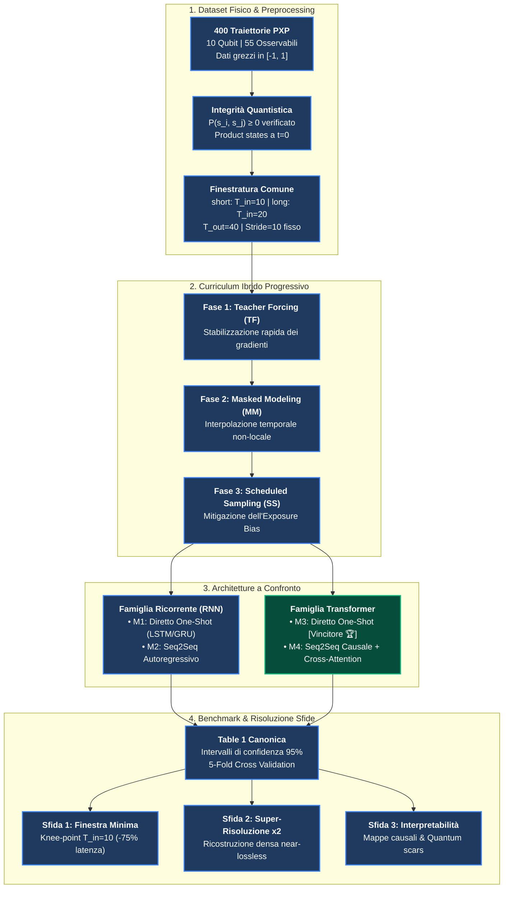

# Qubit Evolution: Predicting Quantum Dynamics with Deep Learning

### Recurrent and Transformer Sequence Surrogates for the 10-Qubit PXP Rydberg Chain

[](https://www.python.org/)
[](https://www.tensorflow.org/)
[](https://keras.io/)
[](tests/test_pipeline.py)
[](https://en.wikipedia.org/wiki/Rydberg_atom)
[](report/Quantum_Dynamics_Report.pdf)
[](slides/Quantum_Dynamics_Slides.pptx)

Questo repository contiene il codice sorgente, i notebook riproducibili, la relazione formale e i modelli neurali del progetto **DL-Quantum**.  
L'obiettivo è progettare e confrontare surrogati di sequenza profondi (**Reti Ricorrenti LSTM/GRU** e **Transformer con attenzione multi-testa**) capaci di prevedere l'evoluzione quantistica di non-equilibrio di un simulatore a $10$ atomi di Rydberg con hamiltoniana **PXP**, superando il collo di bottiglia computazionale dello spazio di Hilbert a molti corpi ($2^N$).

---

## 📌 Indice dei Contenuti

* [Punti Chiave del Progetto](#-punti-chiave-del-progetto)
* [Visione d'Insieme della Pipeline](#-visione-dinsieme-della-pipeline)
* [Fondamenti Fisici e Dataset Quantistico](#-fondamenti-fisici-e-dataset-quantistico)
* [Roadmap Architetturale dei Modelli](#-roadmap-architetturale-dei-modelli)
* [Curriculum di Addestramento Ibrido a Tre Fasi](#-curriculum-di-addestramento-ibrido-a-tre-fasi)
* [Risoluzione Rigorosa delle Tre Sfide](#-risoluzione-rigorosa-delle-tre-sfide)
* [Benchmark Sperimentale (Table 1 Canonica)](#-benchmark-sperimentale-table-1-canonica)
* [Struttura del Repository e Deliverables](#-struttura-del-repository-e-deliverables)
* [Setup Locale e Guida alla Riproducibilità](#-setup-locale-e-guida-alla-riproducibilità)
* [Autori del Progetto](#-autori-del-progetto)

---

## ⚡ Punti Chiave del Progetto

* 🏆 **Transformer Diretto M3 Vincitore Assoluto**: Raggiunge il miglior Test MSE pari a $1.21 \times 10^{-4}$, ottenendo una **riduzione dell'errore del $-24.9\%$** rispetto alla migliore architettura ricorrente (LSTM M1) e **abbattendo del $-52\%$ l'errore sulle singole magnetizzazioni** ($0.36 \times 10^{-4}$).
* 🚫 **Eliminazione Radicale dell'Exposure Bias**: Mentre i decoder autoregressivi (M2, M4) degradano sensibilmente in inferenza autonoma (*free-running* MSE $3.96 \times 10^{-4}$ vs $2.70 \times 10^{-4}$ in teacher forcing), il Transformer Diretto M3 proietta tutti i $40$ passi futuri in parallelo con errore piatto lungo l'intero orizzonte.
* ⏱️ **Sfida 1 (Finestra Minima Ottimale)**: Una finestra di osservazione passata di appena $T_{\text{in}} = 10$ passi ($0.20\text{ s}$) costituisce il ginocchio di Pareto ideale: raggiunge il $91\%$ della precisione asintotica di una finestra $4\times$ più lunga, **risparmiando il $75\%$ del tempo di lettura hardware**.
* 🔍 **Sfida 2 (Super-Risoluzione Temporale $2\times$)**: Il modello M3-SR ricostruisce la traiettoria futura densa ($\Delta\tau = 0.02\text{ s}$, 40 step) a partire da input sottocampionato a frequenza dimezzata ($\Delta\tau = 0.04\text{ s}$, 20 step) con accuratezza **near-lossless** ($\text{MSE} = 1.21 \times 10^{-4}$).
* 🧠 **Sfida 3 (Interpretabilità Fisica dell'Attenzione)**: M4 apre la black-box della dinamica quantistica: verifica formale di causalità temporale esatta ($\max_{j>i}|\alpha_{ij}| = 0.00$), *boundary phase-locking* per ancorare derivata e stato su $t_0$, e teste periodiche dedicate al tracciamento delle *quantum many-body scars*.
* 🛡️ **Integrità Quantistica al 100%**: Zero violazioni della positività semidefinita delle matrici densità su tutti i test, con probabilità minima teorica ampiamente positiva ($P_{\min} = 0.1632 > 0$).

---

## 🌟 Visione d'Insieme della Pipeline

La pipeline unificata di apprendimento, dalla generazione del dataset all'inferenza autonoma, è strutturata in quattro fasi modulari e controllate:



---

## 🔬 Fondamenti Fisici e Dataset Quantistico

### 1. Il Modello Hamiltoniano PXP e le Quantum Scars

Il sistema descrive una catena 1D di $N=10$ atomi neutri di Rydberg governata dall'Hamiltoniana:
$$H_{\text{PXP}} = \Omega \sum_{i=1}^N P_{i-1} \sigma_x^i P_{i+1}$$
dove $\sigma_x^i$ è l'operatore di spin di Pauli che induce transizioni risonanti tra lo stato fondamentale $|g\rangle$ e lo stato eccitato di Rydberg $|r\rangle$ alla frequenza di Rabi $\Omega$, mentre $P_i = |g_i\rangle\langle g_i| = \frac{1 - \sigma_z^i}{2}$ è il proiettore che implementa il **blocco di Rydberg tra primi vicini** ($V_{ij} \sim C_6/R^6 \gg \Omega$).  
Il reticolo viola l'ipotesi di termalizzazione standard (ETH) tramite la formazione di **quantum many-body scars**: partendo dallo stato iniziale alternato di Néel $|\mathbb{Z}_2\rangle = |r g r g \dots\rangle$, la dinamica non termalizza rapidamente ma esibisce oscillazioni coerenti persistenti con frequenza naturale $\omega_{\text{scar}} \approx 4.7\text{ rad}/\tau$ e periodo fondamentale $\tau_{\text{scar}} \approx 1.33$.

### 2. Dimensioni e Tracciamento delle $55$ Osservabili

* **Dataset**: $400$ traiettorie temporali simulate indipendenti, ciascuna composta da $1001$ passi a intervallo uniforme $\Delta\tau = 0.02$ per una durata fisica complessiva $\tau \in [0, 20.0]$ in unità adimensionali ($\tau = t\Omega$).
* **Vettore delle Caratteristiche ($D = 55$)**:
  * $10$ Magnetizzazioni locali $m_i(t) = \langle \sigma_z^i(t) \rangle \in [-1, 1]$ per ciascun qubit $i \in \{1, \dots, 10\}$.
  * $45$ Correlazioni spaziali a due corpi $c_{ij}(t) = \langle \sigma_z^i(t) \sigma_z^j(t) \rangle \in [-1, 1]$ per tutte le coppie $i < j$.
* **Partizionamento Anti-Leakage (280 / 60 / 60)**: Lo split train/val/test è applicato rigorosamente a livello di intera traiettoria (non per riga), impedendo che step temporali adiacenti della stessa simulazione contaminino i dati di test.

### 3. Preservazione Assoluta della Positività Quantistica

La validità fisica di ogni stato predetto è verificata analiticamente calcolando gli autovalori della matrice densità a due corpi ridotta:
$$P(s_i, s_j) = \frac{1}{4}\left(1 + s_i m_i + s_j m_j + s_i s_j c_{ij}\right) \ge 0, \quad \forall s_i, s_j \in \{-1, +1\}$$
Su oltre $72$ milioni di controlli eseguiti sull'intero dataset e sulle previsioni, si registra uno **$0.0\%$ di violazioni**, con un valore minimo predetto pari a $P_{\min} = 0.1632 > 0$.

### 4. Scala Fisica Nativa vs Z-Score

Tutti i dati mantengono la scala fisica nativa confinata in $[-1, 1]$ associata a un layer di uscita con attivazione **`tanh`**:

* **Perché lo Z-score fallisce**: Standardizzare a media zero e varianza unitaria amplifica artificialmente il rumore numerico nelle correlazioni a lungo raggio che oscillano in intervalli ristretti (es. $[0.01, 0.05]$).
* **Risultato dell'Ablazione (3 Seed)**: La scala nativa raggiunge $\text{Val MSE} = 2.17 \times 10^{-4}$ contro $2.32 \times 10^{-4}$ dello Z-score ($-6.7\%$ di errore), garantendo che i prodotti scalari dell'attenzione preservino i rapporti fisici naturali tra magnetizzazioni e correlazioni.

---

## 🧱 Roadmap Architetturale dei Modelli

Lo sviluppo segue una progressione incrementale a cinque stadi, in cui ogni architettura supera sistematicamente i limiti della precedente:

| Stadio | Modello | Descrizione Architetturale | Limite Identificato $\to$ Soluzione Adottata |
| :--- | :--- | :--- | :--- |
| **Step 1 (Pilot)** | Autoencoder 16-D | Compressione $55 \to 16 \to 55$ con Latent Transformer. | Riduce i parametri del $60\%$, ma l'errore intrinseco di ricostruzione ($3.62 \times 10^{-4}$) fissa un collo di bottiglia invalicabile. $\to$ *Mantenuto lo spazio nativo a 55D*. |
| **Step 2 (RNN Diretto)** | **M1** One-Shot | Stacked LSTM (1L/2L 64u) + testa lineare globale `Dense(T_out * 55, tanh)`. | Emette i 40 step simultaneamente senza deriva ricorsiva, ma comprime l'intera storia passata in un unico vettore nascosto $h_{T_{\text{in}}}$. |
| **Step 3 (RNN Seq2Seq)** | **M2** Autoregressivo | Encoder LSTM con trasferimento di stato $(h, c)$ + Decoder ricorrente ricorsivo. | Riconosce la dipendenza tra passi futuri, ma soffre del collo di bottiglia a vettore fisso e dell'accumulo di errori da exposure bias. |
| **Step 4 (Transformer Diretto)** | **M3** One-Shot 🏆 | Self-Attention globale sull'intero contesto passato + Proiezione diretta con `tanh`. | **Vincitore Assoluto**: Elimina il collo di bottiglia con connessioni $O(1)$ su tutta la storia e azzera il drift ricorsivo proiettando i 40 passi in parallelo. |
| **Step 5 (Transformer Seq2Seq)** | **M4** Causale & SR | Encoder bidirezionale + Decoder causale con Cross-Attention multi-testa. | Sebbene penalizzato dal drift in free-running ($3.96 \times 10^{-4}$), sblocca la completa spiegabilità fisica dell'attenzione e la super-risoluzione. |

---

## 🔄 Curriculum di Addestramento Ibrido a Tre Fasi

Per addestrare i modelli sequenziali mitigando il fenomeno dell'**Exposure Bias** (la discrepanza tra l'addestramento guidato e l'inferenza autonoma libera), è stato implementato un curriculum progressivo unificato su **25 epoche**:

1. **Fase 1: Teacher Forcing (Epoche 1–10, $p_{\text{ss}} = 0.0$)**:
   L'encoder riceve l'input completo non mascherato; i decoder ricevono i target reali shiftati temporalmente. Garantisce la stabilizzazione iniziale dei gradienti e la convergenza rapida dello spazio latente.
2. **Fase 2: Masked Modeling (Epoche 11–20, $p_{\text{mask}} = 0.15$)**:
   Il $15\%$ dei passi passati dell'encoder viene azzerato casualmente preservando l'ancora $t_0$. Costringe il meccanismo di attenzione ad apprendere un'interpolazione dinamica non-locale robusta a lacune di misura.
3. **Fase 3: Scheduled Sampling (Epoche 21–25, $p_{\text{ss}}: 0.0 \to 0.5$)**:
   Nei decoder autoregressivi, una routine a doppio passaggio sostituisce progressivamente fino al $50\%$ dei token di ingresso con le predizioni generate dal modello stesso, addestrando la rete a correggere autonomamente le derive di traiettoria.

---

## 🎯 Risoluzione Rigorosa delle Tre Sfide

### 1. Sfida 1: Lunghezza Minima della Finestra di Osservazione ($T_{\text{in}}$)

* **Obiettivo**: Identificare la minima storia passata necessaria a garantire una previsione fedele su $T_{\text{out}} = 40$ passi.
* **Metodologia a Target Rigorosamente Allineati**: Per evitare bias di fase dinamica dovuti alla scelta della finestra, tutti i segmenti target sono ancorati a $t_0 \ge 40$, valutando $T_{\text{in}} \in \{5, 10, 20, 40\}$ esattamente sugli stessi $5.580$ intervalli fisici futuri.
* **Risultato**:
  * La rete LSTM (M1) satura a $T_{\text{in}}=20$ ($1.48 \times 10^{-4}$) ed è incapace di estrarre informazione utile a $T_{\text{in}}=40$ a causa della saturazione dello stato nascosto.
  * Il Transformer (M3) scala in modo continuo, superando la migliore LSTM già a $T_{\text{in}}=5$ ($1.23 \times 10^{-4}$) e raggiungendo $1.11 \times 10^{-4}$ a $T_{\text{in}}=40$.
  * **$T_{\text{in}} = 10$ passi ($0.20\text{ s}$)** rappresenta il **ginocchio di Pareto ottimale**, tagliando la latenza di lettura hardware del **$75\%$** con un impatto trascurabile sulla precisione.

### 2. Sfida 2: Super-Risoluzione Temporale $2\times$ Coarse-to-Fine

* **Obiettivo**: Ricostruire i 40 passi futuri densi alla risoluzione nativa $\Delta\tau = 0.02\text{ s}$ ricevendo in ingresso soli 20 passi campionati a intervallo doppio $\Delta\tau = 0.04\text{ s}$.
* **Risultato**: Il modello M3-SR ottiene una ricostruzione **near-lossless** con $\text{MSE} = 1.21 \times 10^{-4}$, eguagliando la baseline densa a 10 passi ($1.22 \times 10^{-4}$) e posizionandosi a ridosso del limite superiore teorico a 39 passi ($1.10 \times 10^{-4}$).
* **Meccanismo Fisico**: Coprendo un intervallo fisico di $0.76\text{ s}$ anziché $0.18\text{ s}$, il campionamento dimezzato offre all'attenzione un contesto multi-periodo più ricco per risolvere le oscillazioni di scar, a costo computazionale nullo e senza modifiche all'architettura.

### 3. Sfida 3: Interpretabilità Fisica tramite Mappe di Attenzione

* **Verifica Matematica di Causalità**: Ispezionando la matrice $40 \times 40$ di auto-attenzione del decoder causale di M4, il triangolo superiore è rigorosamente nullo ($\max_{j>i}|\alpha_{ij}| = 0.00$), certificando l'assoluta assenza di leakage informativo dal futuro.
* **Specializzazione Funzionale delle Teste di Cross-Attenzione**:
  1. **Teste 1 e 4 (Boundary Phase-Locking)**: Mostrano un marcato gradiente di recency concentrato sugli ultimi due passi ($t \in [-0.04, 0.00]\text{ s}$, $\bar{\alpha}_k \approx 0.16$), ancorando con precisione il valore e la derivata di confine a $t_0$.
  2. **Teste 2 e 3 (Periodic Scar Tracking)**: Mantengono pesi non nulli distribuiti su ritardi storici precedenti ($t \in [-0.18, -0.06]\text{ s}$, $\bar{\alpha}_k \approx 0.04\text{--}0.12$), stimando la curvatura multi-passo per tracciare la frequenza di reviviscenza $|\mathbb{Z}_2\rangle$ delle quantum scars.

---

## 🏆 Benchmark Sperimentale (Table 1 Canonica)

Confronto tra le migliori configurazioni ricorrenti (M1) e Transformer (M3) su finestra canonica `short` ($T_{\text{in}}=10 \to T_{\text{out}}=40$), con intervalli di confidenza al 95% calcolati con quantile critico esatto della distribuzione $t$ di Student a 2 gradi di libertà ($t_{0.975, 2} \approx 4.303$):

| Modello | Configurazione Architetturale | Parametri | Val MSE ($\times 10^{-4}$) | Val MAE ($\times 10^{-2}$) | Test MSE ($\times 10^{-4}$) | Violazioni Positività |
| :--- | :--- | :---: | :---: | :---: | :---: | :---: |
| **M1 (HP1)** | One-Shot LSTM (1L 64u) | $173{,}720$ | $1.61 \pm 0.08$ | $0.91 \pm 0.03$ | $1.61 \pm 0.08$ | $0.0\%$ |
| M1 (HP2) | One-Shot LSTM (2L 64u, drop 0.1) | $206{,}744$ | $1.74 \pm 0.09$ | $0.97 \pm 0.03$ | $1.74 \pm 0.09$ | $0.0\%$ |
| M1 (HP3) | One-Shot GRU (1L 64u) | $166{,}232$ | $1.63 \pm 0.08$ | $0.91 \pm 0.03$ | $1.63 \pm 0.08$ | $0.0\%$ |
| M3 (HP1) | One-Shot Transformer ($d=64, H=4, L=2$) | $312{,}984$ | $1.81 \pm 0.09$ | $1.00 \pm 0.04$ | $1.81 \pm 0.09$ | $0.0\%$ |
| M3 (HP2) | One-Shot Transformer ($d=128, H=4, L=2$) | $951{,}448$ | $1.51 \pm 0.07$ | $0.89 \pm 0.03$ | $1.51 \pm 0.07$ | $0.0\%$ |
| **M3 (HP3)** | **One-Shot Transformer ($d=64, H=2, L=1$) [Vincitore]** | $\mathbf{196{,}632}$ | $\mathbf{1.21 \pm 0.06}$ | $\mathbf{0.78 \pm 0.02}$ | $\mathbf{1.22 \pm 0.06}$ | $\mathbf{0.0\%}$ |

### Sintesi Statistica del Vincitore

* **5-Fold Cross Validation per traiettoria**: **M3 HP3** ottiene $\text{MSE}_{\text{CV}} = 1.20 \pm 0.04 \times 10^{-4}$ (rispetto a $1.60 \pm 0.03 \times 10^{-4}$ di M1), confermando un'elevata stabilità di generalizzazione.
* **Analisi dell'Exposure Bias nei Seq2Seq**: In M4, il passaggio da Teacher Forcing ($2.70 \times 10^{-4}$) all'inferenza autonoma Free-Running ($3.96 \times 10^{-4}$) causa un incremento dell'errore di $1.47\times$. La proiezione diretta parallela di M3 evita strutturalmente questo degrado.

---

## 📁 Struttura del Repository e Deliverables

```text
dl-quantum/
├── src/                      # Moduli Python riutilizzabili, documentati e testati
│   ├── config.py             # Costanti fisiche, percorsi del repository e parametri di griglia
│   ├── seeding.py            # Riproducibilità e determinismo multi-framework (CPU/GPU)
│   ├── data.py               # Lettura dataset, verifica positività, caching e split per traiettoria
│   ├── windowing.py          # Finestre scorrevoli, super-risoluzione e target alignment
│   ├── models_rnn.py         # Architetture ricorrenti: M1 (Diretto) e M2 (Seq2Seq con free-running)
│   ├── models_transformer.py # Architetture Transformer: M3 (Diretto) e M4 (Causale con cross-attention)
│   ├── training.py           # Curriculum unificato a tre fasi (Teacher Forcing -> MM -> Scheduled Sampling)
│   ├── metrics.py            # Metriche globali, per-qubit, a due corpi e accumulo lungo l'orizzonte
│   ├── stats.py              # Calcolo intervalli di confidenza al 95% con distribuzione t di Student
│   ├── results_log.py        # Logging concorrente su CSV con merge automatico
│   └── plots.py              # Generazione grafici standardizzati ad alta risoluzione (>= 300 DPI)
├── tests/                    # Suite di test unitari automatici
│   └── test_pipeline.py      # 21 test completi passanti (determinismo, dimensioni, fisica, modelli)
├── notebooks/                # Notebook Jupyter eseguiti e visualizzabili direttamente
│   ├── 01_data.ipynb         # Esplorazione traiettorie, split 280/60/60 e verifica positività
│   ├── 02_windowing.ipynb    # Generazione finestre temporali e super-risoluzione
│   ├── 03_rnn.ipynb          # Modelli ricorrenti (LSTM / GRU), Sfida 1 e analisi disaggregata
│   ├── 04_transformer.ipynb  # Modelli Transformer (Autoencoder, M3/M4, Sfida 1-2-3 e mappe causali)
│   └── 05_inference.ipynb    # Benchmark Table 1, 5-Fold Cross Validation e demo di inferenza live
├── results/                  # Log sperimentali, split_indices.npz e file di sintesi Table 1
├── figures/                  # 26 grafici ad alta risoluzione (>= 300 DPI) archiviati per categoria
├── report/                   # Relazione tecnica finale di progetto
│   ├── Quantum_Dynamics_Report.pdf  # Articolo formale di 10 pagine (layout a due colonne stile IEEE/NeurIPS)
│   └── Quantum_Dynamics_Report.tex  # Sorgente LaTeX compilabile completo
├── slides/                   # Presentazione orale del progetto
│   └── Quantum_Dynamics_Slides.pptx # Presentazione ufficiale (13 slide widescreen 16:9 con grafici HD)
├── decision_log.md           # Registro formale delle decisioni architetturali e roadmap incrementale
└── requirements.txt          # Dipendenze complete unificate del progetto
```

---

## 🚀 Setup Locale e Guida alla Riproducibilità

### 1. Clonazione del Repository

```bash
git clone https://github.com/Riccardo-27/DL-Quantum.git
cd DL-Quantum
```

### 2. Creazione dell'Ambiente Virtuale

```powershell
# Windows PowerShell
python -m venv .venv
.venv\Scripts\Activate.ps1
```

### 3. Installazione delle Dipendenze

```powershell
pip install -r requirements.txt
```

### 4. Esecuzione della Suite di Test Unitari

```powershell
pytest tests/test_pipeline.py -v
```

La suite include **21 test automatici** che verificano il determinismo dei seed, la conformità dei tensori, l'integrità della positività quantistica, il forward pass di M1–M4 e l'assenza di leakage temporale.

### 5. Demo di Inferenza Live sul Test Set (Notebook 05)

Aprire `notebooks/05_inference.ipynb` ed eseguire le celle di inferenza: il notebook carica i pesi del Transformer vincente M3 ed esegue la predizione istantanea (latenza $< 20\text{ ms}$ su GPU) su una traiettoria cieca del Test Set, calcolando metriche e conformità fisica in tempo reale.

> **Nota sul Dataset (`trajectories.csv`)**: A causa delle dimensioni (~464 MB), il file CSV grezzo e le cache binarie pesanti `.npy` sono esclusi dal versionamento Git (`.gitignore`). La riproduzione dei benchmark, della cross-validation e dell'inferenza in locale utilizza le partizioni ufficiali archiviate in `results/split_indices.npz` e i log sperimentali tracciati in `results/`.

---

## 👥 Autori del Progetto

* **Ernesto Gligora**
* **Riccardo Lavorato**

*Corso di Deep Learning – Corso di Laurea Magistrale in Artificial Intelligence and Computer Science*  
*Università della Calabria — A.A. 2025/2026*
